<!--            Cheat Sheet
paragraphe    

gras          <b>reconnaissance faciale</b>
italique      <i>deep learning</i>
saut de ligne   
lien externe  <a href="https://example.com">example</a>
-->

# Types d'interaction dans les modèles denses

Les modèles denses peuvent être classés en fonction de leur type d'« interaction ».
  
Un modèle de recherche dense est un modèle qui utilise un certain type d'architecture pour récupérer les documents pertinents pour une requête de recherche. Dans ce contexte, le terme « interaction » fait référence au processus d'évaluation de la correspondance entre un document et une requête de recherche donnée en comparant leurs représentations. Cette section aborde les différents types d'interactions dans les modèles de recherche dense.

 

## Modèles sans interaction

Les méthodes de recherche traditionnelles utilisent des modèles sans interaction. Dans ce cas, la requête et les documents sont traités séparément :

<ol>
  <li style="text-align:justify;">Au cours de la phase d'indexation, un vecteur dense est calculé au préalable pour chaque document. Le document (en pratique un morceau de ce document de taille de séquence équivalente à celle que le modèle peut gérer au maximum) est d'abord divisé en tokens, puis ils sont passés ensemble dans un modèle afin d'obtenir des embeddings denses pour chacun d’eux. Enfin, les embeddings sont combinés par le biais d'un pooling pour les ramener à une seule représentation vectorielle.</li>
  <li style="text-align:justify;">Au cours de la phase d'interrogation, un vecteur est calculé pour la requête afin de rechercher des documents similaires dans une base de recherche d’embeddings de documents précalculés via une métrique de similarité (par exemple, le produit scalaire ou la similarité cosinus).</li>
</ol>

<figure class="image">
  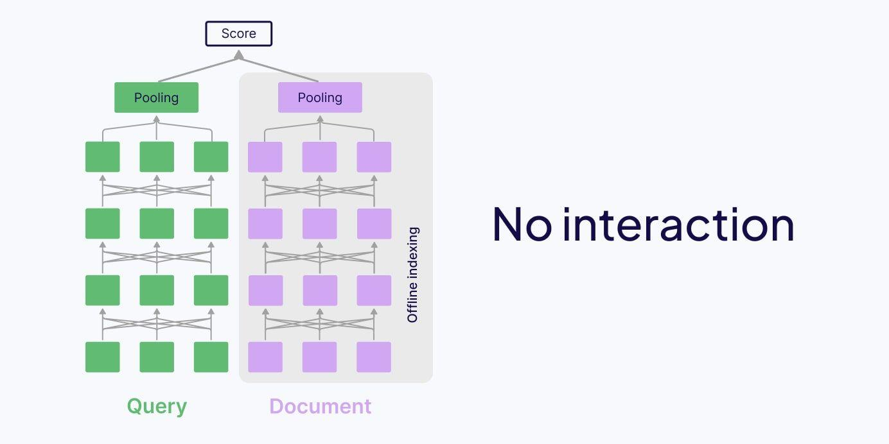
  <figcaption>
  <i>Source : <a href="https://weaviate.io/blog/late-interaction-overview">https://weaviate.io/blog/late-interaction-overview</a></i>
  </figcaption>
</figure>

➕ Les avantages de ce type de modèle sont qu’ils sont rapides et efficaces en termes de calcul. Les représentations vectorielles des documents sont déjà précalculées et indexées hors ligne, et au moment de l'interrogation, seul l’embedding de la requête doit être calculé. Cette solution passe donc à l’échelle.
  
➖ Les inconvénients de ce type de modèle résident dans l'absence d'interaction entre la requête et les documents. C'est-à-dire que comme la requête et les documents sont traités séparément et compressés en un seul vecteur, cette approche peut ne pas tenir compte des nuances contextuelles. Toutes les nuances contextuelles partagées d'un token à l'autre doivent être compressées avant que la comparaison n'ait lieu - ce qui signifie que la similarité est comparée entre l'ensemble du document et l'ensemble de la requête, plutôt qu'au niveau de chaque token.
  
Ces caractéristiques rendent les modèles sans interaction particulièrement adaptés à la première étape de la recherche, c'est-à-dire celle où un top-k est extrait d'une vaste collection de documents.
  
<u>Note</u> : on parle généralement de modèle bi-encodeur (un même réseau de neurones de type encodeur mais où on traite la requête et les documents séparément).

 

## Modèles avec interaction complète

Les modèles avec interaction complète traitent la requête et les documents ensemble. Contrairement aux modèles sans interaction, ils traitent tout au moment de la requête. Pour ce faire, la requête est concaténée avec chaque document, puis ils sont traités ensemble pour une attention croisée complète.

<figure class="image">
  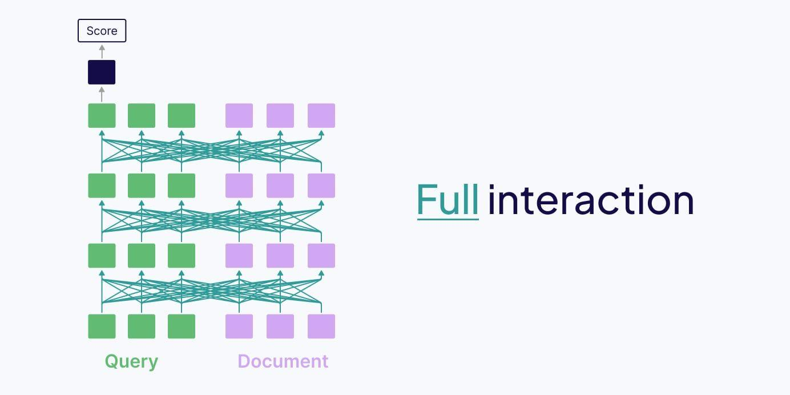
  <figcaption>
  <i>Source : <a href="https://weaviate.io/blog/late-interaction-overview">https://weaviate.io/blog/late-interaction-overview</a></i>
  </figcaption>
</figure>

➕ Les avantages de ces modèles découlent de leur richesse contextuelle, ce qui signifie qu'ils capturent efficacement les relations contextuelles nuancées entre la requête de recherche et le document.
  
➖ Les inconvénients sont dus au fait qu'ils sont extrêmement coûteux en termes de calcul, car tous les documents doivent être traités au moment de la requête. Ils ne sont donc pas extensibles à de grandes quantités de documents.
  
Ces caractéristiques font que ces modèles sont parfaits pour la seconde étape de la recherche consistant à réordonner/reclasser le top-k obtenu par le modèle sans interaction.
  
On a alors comme pipeline : un bi-encodeur trouvant un top-k (Google utilise k=8 par exemple) rapidement dans une base de données, puis le reranker qui est plus lent mais plus précis se charge de reclasser les éléments du top-k.
  
<u>Note</u> : on parle généralement de modèle cross-encodeur (un même réseau de neurones de type encodeur traitant en même temps la requête et les documents).

 

## Modèles avec interaction tardive

Alors que les modèles sans interaction sont rapides mais peuvent être imprécis, que les modèles avec interaction complète sont précis mais lents, les modèles avec interaction tardive promettent d'être à la fois l'un et l'autre puisqu’ils s'inspirent des deux approches précédentes.

<figure class="image">
  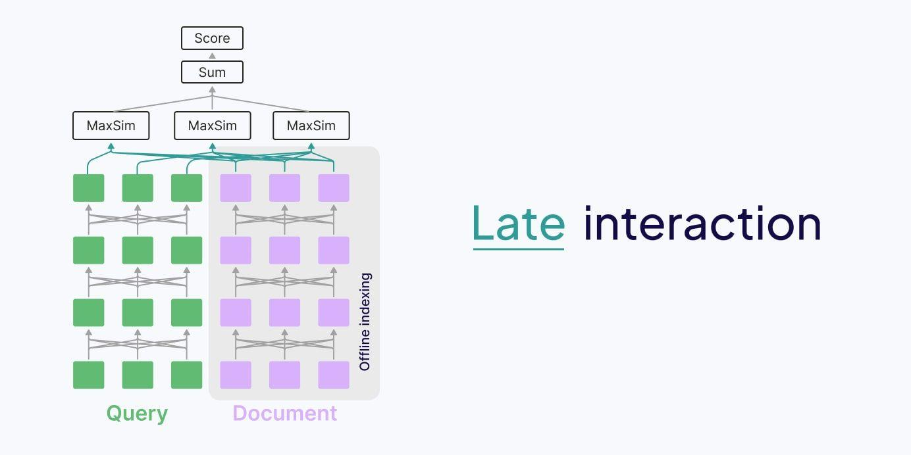
  <figcaption>
  <i>Source : <a href="https://weaviate.io/blog/late-interaction-overview">https://weaviate.io/blog/late-interaction-overview</a></i>
  </figcaption>
</figure>

Comme les modèles sans interaction, les modèles avec interaction tardive ont une architecture à bi-encodeur et calculent préalablement les embeddings avant l'étape de requêtage.
  
Toutefois, dans le cas d'une interaction tardive, les embeddings stockés sont ceux de chaque token plutôt qu'un embedding unique pour l'ensemble de la séquence.
  
En effet, au lieu de mettre en commun ces embeddings des tokens via un pooling, ce mécanisme est remplacé par celui d'interaction tardive.
  
Globalement, cela signifie que les embeddings multi-vectoriels au niveau des tokens sont conservés pour calculer l'interaction entre la requête et les représentations multi-vectorielles du document.
  
➕ L’avantage de ces modèles est qu’ils passent à l’échelle tout en étant riches sur le plan contextuel.
  
➖ L’inconvénient est qu’ils nécessitent un embedding pour chaque token, ce qui requiert beaucoup plus de stockage que les autres approches.
  
Notons que pour atténuer ce problème, les embeddings des tokens peuvent être stockés dans une dimension et un niveau de quantification beaucoup plus faibles afin de réduire les coûts de calcul et d'accroître l'efficacité du stockage. Par exemple, dans ColBERTv2, une quantification agressive est effectuée pour réduire la taille de chaque vecteur de 256 octets à 36 octets (compression sur 2 bits) ou même 20 octets (compression sur 1 bit), tout en maintenant un bon niveau de précision (voir la section ColBERTv2 plus loin).

  

# Comment fonctionne le mécanisme d'interaction tardive ?

Le mécanisme d'interaction tardive calcule le score de similarité maximal entre les tokens de la requête et les tokens du document. On est donc sur des représentations au niveau du token. L'interaction tardive a été introduite pour la première fois dans le papier du <a href="https://arxiv.org/abs/2004.12832">ColBERT</a> :

<figure class="image">
  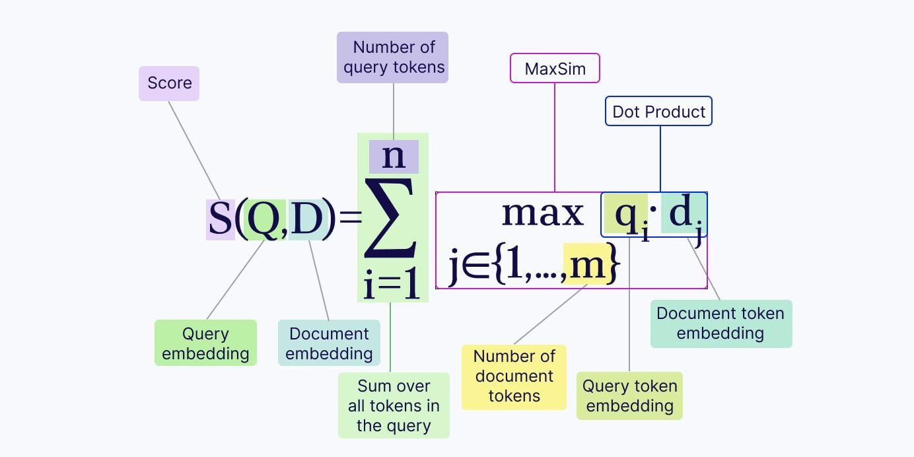
  <figcaption>
  <i>Source : <a href="https://weaviate.io/blog/late-interaction-overview">https://weaviate.io/blog/late-interaction-overview</a></i>
  </figcaption>
</figure>

Au lieu de faire un pooling sur les embeddings de la requête et des documents comme pour l’interaction complète, nous appliquons l'opérateur MaxSim pour calculer les scores de pertinence :

<ol>
  <li style="text-align:justify;">Pour chaque token de la requête, nous calculons son score de similarité (par exemple, le produit scalaire ou la similarité cosinus) avec chaque token du document.</li>
  <li style="text-align:justify;">Ensuite, pour chaque token de la requête, nous ne conservons que le score de similarité maximal.</li>
  <li style="text-align:justify;">Enfin, nous additionnons tous ces scores de similarité maximale au niveau du token afin d’obtenir un score de pertinence final.</li>
</ol>

<b>Note</b> : 
<a href="https://huggingface.co/blog/fsommers/document-similarity-colpali#colbert-style-katexparse6marker">https://huggingface.co/blog/fsommers/document-similarity-colpali#colbert-style-katexparse6marker</a> donne un exemple afin de calculer le MaxSim à la main pour 1 requête et deux documents (et donc trouver lequel des 2 documents est le plus similaire à la requête).
  
Un autre schéma peut-être plus visuel provenant d’un cours de Stanford par le directeur de thèse du doctorant qui a créé le ColBERT (voir la section suivante).

<figure class="image">
  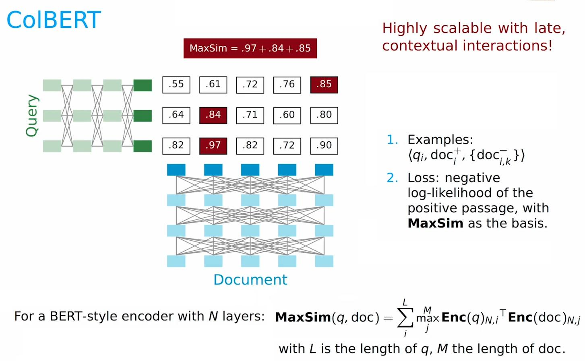
  <figcaption>
  <i>Source : <a href="https://www.youtube.com/watch?v=EDVqG86AT0Q&t">https://www.youtube.com/watch?v=EDVqG86AT0Q&t</a></i>
  </figcaption>
</figure>

  

# Qu'est-ce que ColBERT ?

Le papier du <a href="https://arxiv.org/abs/2004.12832">ColBERT</a>, Contextualized Late Interaction over BERT, publié en 2020, a introduit le ColBERT original (le v1) et le mécanisme d'interaction tardive.

 

## Architecture du ColBERT

Étant donné que ColBERT est un finetuning de BERT, son architecture est presque identique à celle de BERT mais il existe des différences. 
Tout d'abord, BERT-base utilise une dimension fixe de taille 768 (1024 pour BERT-large), alors que ColBERT utilise une dimension plus petite de taille 128 pour chaque vecteur dans le but de réduire les besoins de stockage de chaque vecteur (ColBERT nécessitera alors quand même nb_de_documents/6 fois plus de stockage que l’approche sans interaction tardive). Pour ce faire, ColBERT utilise une couche de projection afin que le résultat final soit un vecteur à 128 dimensions.
  
De plus, deux tokens spéciaux supplémentaires, [Q] et [D], sont ajoutés à la requête et au document respectivement pour les « marquer » en tant que tels. Ce marqueur est inclus dans l'entraînement du modèle, de sorte que le modèle apprend à distinguer la requête et le document par le biais de ces tokens spéciaux.
  
Une passe avant complète de ColBERT est ainsi :

<ol>
  <li style="text-align:justify;">Tokeniser la requête/le document (et inclure le token spécial [Q] ou [D])</li>
  <li style="text-align:justify;">Passer les tokens à travers un BERT 110M</li>
  <li style="text-align:justify;">Projeter les représentations finales du BERT à l'aide d'une couche de projection spéciale afin de réduire la dimension d'intégration à 128 au lieu de 768.</li>
  <li style="text-align:justify;">Comparer tous les tokens entre la requête et le document en utilisant l'interaction tardive et la MaxSim.</li>
</ol>

<figure class="image">
  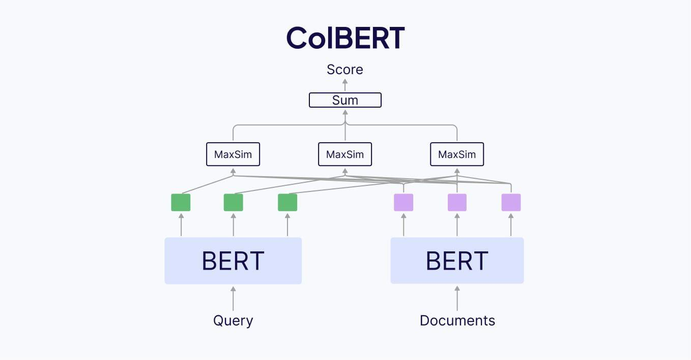
  <figcaption>
  <i>Source : <a href="https://weaviate.io/blog/late-interaction-overview">https://weaviate.io/blog/late-interaction-overview</a></i>
  </figcaption>
</figure>

 

## ColBERT v2 et ses améliorations

Alors que ColBERT a introduit le concept d'interaction tardive, <a href="https://arxiv.org/abs/2112.01488">ColBERTv2</a> l'a affiné. Le principal inconvénient de ColBERT réside dans ses exigences en matière de stockage : il faut un vecteur complet pour chaque token dans chaque document. ColBERTv2 améliore la faiblesse de la version originale de ColBERT, à savoir les énormes besoins de stockage en mémoire, tout en améliorant la qualité de la recherche.
  
L'amélioration de la qualité de ColBERTv2 provient d'un processus appelé supervision débruitée, qui implique la distillation d'un modèle plus large et le hard negative mining (associer des documents proches à celui recherché via une requête mais incorrects).
  
La distillation a été effectuée à partir du modèle <a href="https://arxiv.org/abs/2002.10957">MiniLM</a> (2020). Ce modèle cross-encodeur utilise l'interaction complète ce qui signifie qu'il a une grande précision, mais qu'il est inefficace à utiliser dans la pratique car trop lent.
  
L'amélioration de l'efficacité du stockage provient de la compression résiduelle. La compression résiduelle est une technique qui stocke les « centroïdes » avec une grande précision (vecteurs plus précis avec un coût de stockage élevé) et les vecteurs « résiduels » avec une faible précision (vecteurs moins précis avec un coût de stockage plus faible). Chaque embedding de token est ainsi une combinaison d'un centroïde et de son propre vecteur résiduel, unique. Ces centroïdes vectoriels occupent plus d'espace, mais ils sont moins nombreux. D'après le papier du ColBERTv2, il est recommandé d'utiliser 16 x sqrt(n_docs x d_emb) vecteurs, qui est une valeur proportionnelle du nombre total d'embeddings dans le jeu de données. L’indexation à base de centroïde est détaillée dans le papier <a href="https://arxiv.org/abs/2205.09707">PLAID</a> (Performance-optimized Late Interaction Driver) par les mêmes auteurs de ColBERT v1 et v2 (travail mené en parallèle de la version V2… on peut voir ColBERT v2 comme une v2.1 et PLAID comme un ColBERT v2.2).

<figure class="image">
  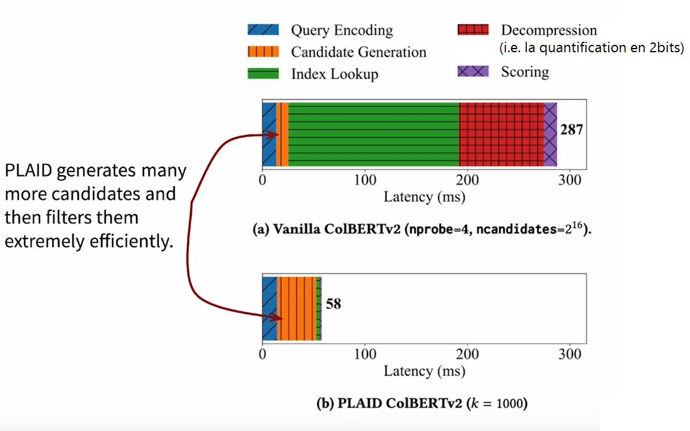
  <figcaption>
  <i>Source : <a href="https://www.youtube.com/watch?v=EDVqG86AT0Q&t">https://www.youtube.com/watch?v=EDVqG86AT0Q&t</a></i>
  </figcaption>
</figure>

L'utilisation de cette technique de compression résiduelle réduit considérablement l'empreinte spatiale. Par exemple, le split d'entraînement de MS MARCO (= jeu de données de référence en IR) avait un index de 154 Go via ColBERTv1, alors qu'avec ColBERTv2 il n'est plus que de 16 Go pour une compression à 1 bit, ou 25 Go pour une compression à 2 bits. Globalement l'empreinte spatiale de ColBERTv2 est réduite 6 à 10 fois par rapport à ColBERTv1, ce qui rapproche cette valeur de ce qu'un modèle à vecteur unique exigerait pour ce jeu de données.

 

## Avantages et limitations de ColBERT

L'un des gros avantages de ColBERT est qu'il permet de passer à l'échelle sur beaucoup de documents tout en étant contextuellement riche. Par conséquent il obtient de meilleurs résultats que les modèles denses classiques.
  
Un autre effet secondaire positif du maintien des embeddings au niveau du token pour l'évaluation de la similarité dans ColBERT est l'ajout d'une fonction d'explicabilité. Comme pour la correspondance par mot-clé, vous pouvez obtenir des informations plus facilement interprétables car vous pouvez voir quels sont les tokens qui ont un score de similarité élevé entre la requête et le document pertinent.

<figure class="image">
  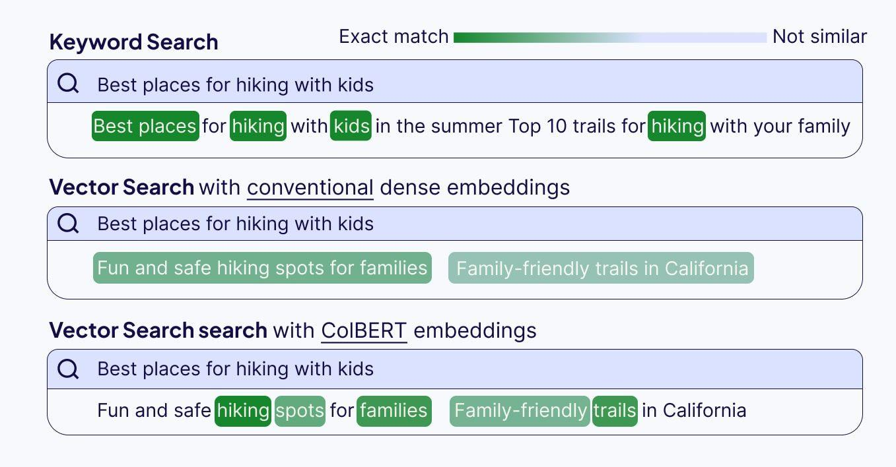
  <figcaption>
  <i>Source : <a href="https://weaviate.io/blog/late-interaction-overview">https://weaviate.io/blog/late-interaction-overview</a></i>
  </figcaption>
</figure>

Comme nous l’avons vu, la principale limitation apparaît au niveau du stockage.
  
Comparons les besoins en stockage des approches uni-vectorielle et multi-vectorielle. Supposons que chaque document se compose de 100 tokens et que nous stockons un nombre variable de documents. Le tableau ci-dessous indique le coût de stockage, en mégaoctets, pour stocker tous les documents selon l'approche considérée :

<figure class="image">
  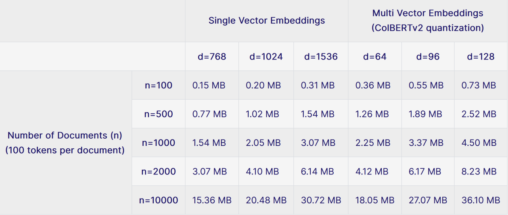
  <figcaption>
  <i>Les coûts de stockage calculés supposent que dans l'approche uni-vectorielle, chaque valeur est légèrement quantifiée à 16 bits par dimension (au lieu de 32), et que l'approche multi-vectorielle est fortement quantifiée à 2 bits par dimension (les centroïdes étant supposés avoir une précision de 16 bits, et le nombre de centroïdes étant donné par la formule de la section précédente). 
  Source : <a href="https://weaviate.io/blog/late-interaction-overview">https://weaviate.io/blog/late-interaction-overview</a></i>
  </figcaption>
</figure>

Même avec une forte quantification, le stockage de vecteurs à 128 dimensions avec ColBERTv2 coûte beaucoup plus cher que le stockage d'un seul vecteur à haute dimension pour l'ensemble du document/chunk. À mesure que la taille des documents et le nombre de tokens augmentent, le coût de stockage augmente également, ce qui pourrait être insoutenable dans certains scénarios. Toutefois, la richesse contextuelle et les performances de recherche accrues pourraient bien valoir le coût du stockage supplémentaire.
  
<b>Note</b> : nous ne sommes pas entrés dans les détails, mais la quantification utilisée par ColBERTv2 est fondamentalement une forme d'indexation IVF-PQ (Inverted File Index-Product Quantisation).

  

# Comment effectuer une recherche efficace dans une base avec un si grand nombre de vecteurs ?

Si la compression des vecteurs de ColBERT est un pas dans la bonne direction, elle ne résout pas le problème de l'éléphant dans la pièce : le coût informatique de la recherche dans des millions de vecteurs.
  
Alors que nous pouvons facilement effectuer une recherche dans des milliers, voire des dizaines de milliers d’embeddings uniques, ColBERT entraînera des ralentissements notables après seulement quelques centaines de documents.
  
C'est logique : nous recherchons dans beaucoup plus de vecteurs et effectuons un très grand nombre de comparaisons. Cela est dû en partie à la manière dont la maxSim fonctionne : non seulement les documents sont représentés par beaucoup plus de vecteurs, mais nous devons également calculer les similarités pour chaque élément de la requête, plutôt qu'une seule fois pour l'ensemble de la requête.
  
En matière de recherche, il est courant de construire un index pour effectuer une recherche approximative de manière très efficace. Les index sont particulièrement puissants : grâce à des méthodes de recherche efficaces, ils sont capables de retrouver des résultats en une poignée de millisecondes.
  
Toutes les méthodes d'indexation pour ColBERT résolvent partiellement ce problème en introduisant une étape de génération de candidats : en fait, au cours de cette étape, nous utilisons une forme de recherche approximative pour prélever jusqu'à k passages, et maxSim ne sera exécuté que sur ces candidats. Cela réduit considérablement le nombre de calculs de similarité que nous devons effectuer. Cela nous permet de traiter entièrement les requêtes en quelques dizaines de millisecondes seulement, même avec des millions de documents.

<figure class="image">
  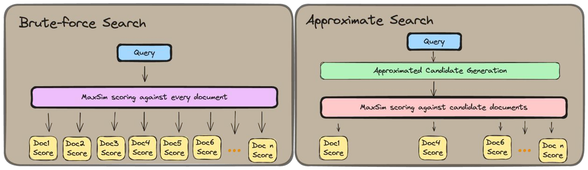
  <figcaption>
  <i>Source : <a href="https://www.answer.ai/posts/colbert-pooling.html">https://www.answer.ai/posts/colbert-pooling.html</a></i>
  </figcaption>
</figure>

Notons que la construction d'index pour générer ces documents candidats est particulièrement coûteuse lorsque l'on stocke un si grand nombre de vecteurs. Il y a deux coûts principaux à cela.
  
Le premier est assez simple : pour toutes les méthodes d'indexation, la construction d'un index ColBERT prend plus de temps que la construction d'un index traditionnel. Il s'agit d'un coût unique au moment de l'indexation.
  
Le second inconvénient, beaucoup plus important, est plus subtil. Le stockage d'un si grand nombre de vecteurs nécessite un mappage complexe de l'index, ce qui se traduit par un compromis important entre les deux méthodes d'indexation les plus utilisées :

<ul>
  <li style="text-align:justify;">L'indexation de type IVF-PQ (= PLAID, l'index par défaut de ColBERTv2) peut passer à l’échelle à des millions et des millions de documents, mais sacrifie les capacités CRUD (CREATE, READ, UPDATE et DELETE) : l'ajout de documents est extrêmement lent (au point que la reconstruction de l'index est plus judicieuse dans de nombreux cas), et la suppression de documents n'est pas prise en charge dans une large mesure.</li>
  <li style="text-align:justify;"><a href="https://www.pinecone.io/learn/series/faiss/hnsw/">HNSW-style indexing</a>, une autre méthode d'indexation très courante, conserve les capacités CRUD, mais passe mal à l'échelle : au fur et à mesure que des documents sont ajoutés, les frais généraux pour chaque nouvel ajout augmentent sensiblement. En outre, la quantification extrême n'est pas aussi facile à utiliser avec ce type d'index et entraînerait des dégradations de performances plus importantes : cela signifie que toutes les implémentations HNSW largement utilisées risquent d'atteindre les limites d'allocation de mémoire lors de la construction d'index « importants » (>10 000 documents).</li>
</ul>

Ces problèmes sont difficiles à résoudre et il n'existe actuellement aucune solution miracle. Les gens <a href="https://www.answer.ai/posts/colbert-pooling.html#key-takeaways">d’answer.ai</a> proposent d’introduire une phase de pooling pour améliorer les choses.

 

## Pooling de tokens

Il ne s'agit en aucun cas d'un nouveau domaine de recherche. Il existe déjà des travaux sur le pruning de tokens, qui consiste à supprimer certains tokens. Différentes approches existent, mais le défi consistant à identifier les tokens à supprimer est toujours complexe, d'autant plus que les « tokens non pertinents » pour certaines requêtes peuvent s'avérer très utiles pour d'autres.
  
En outre, bon nombre de ces approches de réduction du nombre de vecteurs reposent sur des méthodes qui nécessitent des changements de modèle : par exemple, ColBERTer tente de réduire le coût de stockage de ColBERT par une combinaison de techniques, la principale étant l'utilisation de représentations de mots entiers. Cependant, cela nécessite un modèle spécifiquement entraîné et un pipeline considérablement plus complexe.
  
L'idée <a href="http://answer.ai/">d'answer.ai</a> est d'introduire une méthode simple, qui fonctionne avec n'importe quel modèle de représentation multi-vectorielle existant. Pour ce faire, ils utilisent le même concept que celui utilisé pour créer des représentations monovectorielles : le pooling. Cela semble aller à l’encontre de l’idée initiale de ColBERT mais pour eux, le pooling a du bon à petite dose.
  
Leur intuition se base sur le TF-IDF, c’est-à-dire qu’ils partent de l'hypothèse que dans un document donné, l'importance de l'information véhiculée par les différents tokens est très variable : certains tokens sont très informatifs, d'autres très peu informatifs, et les autres se situent entre les deux. De plus, ils supposent aussi que pour les documents se concentrant sur un petit nombre de sujets, un grand nombre de tokens sont susceptibles de véhiculer des informations sémantiques quelque peu redondantes, ce qui signifie qu'il n'est probablement pas utile de tous les conserver.
  
En gardant à l'esprit tout ce qui précède, il est ainsi décidé d'effectuer le pooling au moment de l'indexation.

<figure class="image">
  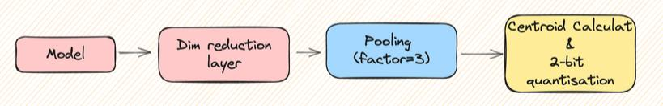
  <figcaption>
  <i>Source : <a href="https://www.answer.ai/posts/colbert-pooling.html">https://www.answer.ai/posts/colbert-pooling.html</a></i>
  </figcaption>
</figure>

D’après leurs expériences (encore préliminaires), la méthode la plus efficace consiste à procéder à un clustering hiérarchique. Il faut donc définir un facteur de pooling. Par exemple, cela signifie que, pour un facteur de pooling de 3 comme dans l’image, nous regrouperons les tokens dans total_tokens_count/3 clusters, réduisant ainsi le nombre total de vecteurs de 66,7 %.
  
Le processus se déroule ensuite en quelques étapes. Pour chaque document, nous

<ul>
  <li style="text-align:justify;">calculons la similarité cosinus entre toutes ses représentations individuelles de tokens</li>
  <li style="text-align:justify;">(Optionnel) protégeons certains tokens, tels que les tokens [CLS] (qui est déjà une représentation groupée) et [D] (qui permet au modèle de savoir qu'on encode un document).</li>
  <li style="text-align:justify;">Créons des clusters total_token_count/Pool_Factor, construits en maximisant la similarité cosinus calculée ci-dessus.</li>
  <li style="text-align:justify;">Itérons à travers les tokens et les ajoutons au cluster dont ils sont le plus proches.</li>
  <li style="text-align:justify;">Appliquons un mean-pooling pour regrouper la représentation des tokens d'un cluster donné en un seul vecteur.</li>
</ul>

À noter que les auteurs obtiennent des résultats plus ou moins performants en fonction du facteur choisi.

<figure class="image">
  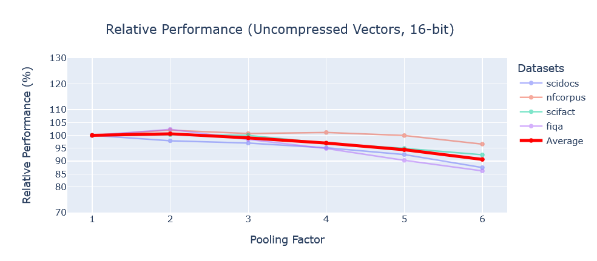
  <figcaption>
  <i>Source : <a href="https://www.answer.ai/posts/colbert-pooling.html">https://www.answer.ai/posts/colbert-pooling.html</a></i>
  </figcaption>
</figure>

Un facteur de 2 permet de réduire de 50 % le nombre de vecteurs tout en apportant une légère amélioration, avec des performances de récupération de 100,6 % en moyenne. En augmentant le facteur à 3, nous obtenons une réduction de 66 %, tout en atteignant 99 % des scores initiaux. En passant à 4, la réduction est de 75 % et les scores de 97 % en moyenne.
  
Notons qu’avec la quantification 2-bits, les performances semblent diminuer (les auteurs creusent toujours ce point car ils obtiennent des valeurs aberrantes pour certains jeux de données).

  

# Bonus : application aux images

ColPali et ColQwen sont des modèles avec interaction tardive utilisant des modèles de langage visuel (VLM) au lieu de modèles textuels. ColPali signifie Contextualized Late Interaction over PaliGemma, tandis que ColQwen signifie Contextualized Late Interaction over Qwen2 (c'est pourquoi il est également appelé ColQwen2). 
Contrairement aux approches conventionnelles pouvant nécessiter de la reconnaissance optique de caractères (OCR), un découpage avancé pour séparer les différents formats de contenu (c'est-à-dire le contenu textuel et le contenu visuel, comme les graphiques ou les images) lors du traitement de documents complexes comme des PDF, ColPali et ColQwen traitent l'ensemble du document comme une image en étendant donc le concept de ColBERT au contenu visuel.

<figure class="image">
  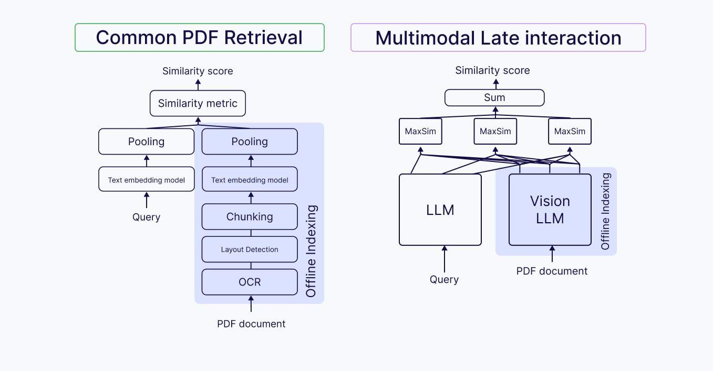
  <figcaption>
  <i>Source : <a href="https://weaviate.io/blog/late-interaction-overview">https://weaviate.io/blog/late-interaction-overview</a></i>
  </figcaption>
</figure>

ColPali et ColQwen traitent les documents complexes sous forme d'images par le biais d'un pipeline similaire :

<ol>
  <li style="text-align:justify;"><b>Transformation en images</b> : Le document entier est traité comme une image plutôt que de séparer le contenu textuel et le contenu visuel, comme le texte, les tableaux et les graphiques.</li>
  <li style="text-align:justify;"><b>Génération de patch</b> : L'image du document est divisée en une série de patchs d'images uniformes de dimensions prédéfinies.</li>
  <li style="text-align:justify;"><b>Encodage</b> : Chaque patch d'image est traité par un encodeur visuel, qui transforme les informations visuelles en embeddings d'images initiaux.</li>
  <li style="text-align:justify;"><b>Contextualisation</b> : Les embeddings des patchs sont transmis à un VLM (PaliGemma dans le cas de ColPali, Qwen2 dans le cas de ColQwen), qui les contextualise dans la structure globale du document.</li>
  <li style="text-align:justify;"><b>Projection dans l'espace vectoriel</b> : Les embeddings contextualisés sont associés dans un espace vectoriel textuel, créant des représentations dans le même espace de recherche qui conservent la conscience des patchs environnants.</li>
  <li style="text-align:justify;"><b>Traitement des requêtes</b> : Les requêtes de l'utilisateur sont enchâssées par le modèle de langage afin de créer des embeddings au niveau du token dans le même espace vectoriel que les patchs du document.</li>
  <li style="text-align:justify;"><b>Interaction tardive</b> : Les tokens de la requête sont mis en correspondance avec les patchs de documents à l'aide d'un opérateur MaxSim.</li>
</ol>

Cette approche préserve les relations contextuelles entre les patchs, de la même manière que les tokens dans ColBERT ont un contexte dans leur phrase entière. Ainsi, lors de l'examen de termes spécifiques de la requête, les modèles peuvent identifier et mettre en évidence les composants visuels et les blocs d'images les plus pertinents dans le document.

 

## Architecture de ColPali

<a href="https://arxiv.org/abs/2407.01449">ColPali</a> (2024) a été créé de la même manière que ColBERT. Ce que BERT est à ColBERT, PaliGemma l'est à ColPali. Essentiellement, au lieu d'utiliser BERT comme encodeur de requête et de document, ColPali utilise PaliGemma qui est séparé en deux parties pour la requête et le document. Comme les requêtes seront toujours textuelles, il utilise Gemma (la partie de PaliGemma réservée au langage) comme encodeur textuel pour les requêtes et PaliGemma (le modèle de vision complet) comme encodeur visuel. Tout comme ColBERT, ColPali stocke les vecteurs de documents précalculés hors ligne et utilise l'interaction tardive pour comparer les requêtes intégrées en ligne au moment de l'exécution. ColPali dispose de ~3B paramètres, 128 dimensions d'intégration, 1024 patchs au maximum.

<figure class="image">
  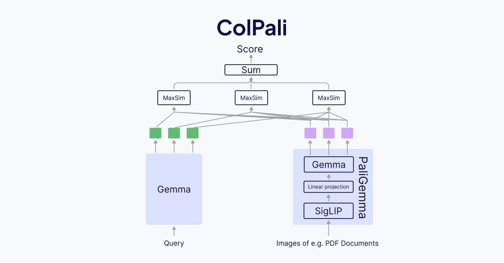
  <figcaption>
  <i>Source : <a href="https://weaviate.io/blog/late-interaction-overview">https://weaviate.io/blog/late-interaction-overview</a></i>
  </figcaption>
</figure>

 

## Architecture de ColQwen

<a href="https://huggingface.co/vidore/colqwen2-v0.1">ColQwen</a> est extrêmement similaire à ColPali. ColQwen utilise Qwen2 LM comme encodeur de requête et Qwen2-VL comme encodeur visuel. Bien que l'architecture soit similaire à celle de ColPali, les détails sont différents en raison de l'utilisation d'un encodeur complètement différent : ~2B paramètres, 128 dimensions d'intégration, taille maximale de 768 patchs. En outre, le modèle est sous licence Apache 2.0.

<figure class="image">
  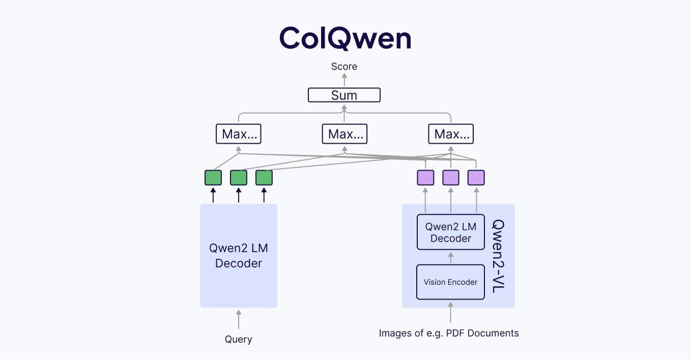
  <figcaption>
  <i>Source : <a href="https://weaviate.io/blog/late-interaction-overview">https://weaviate.io/blog/late-interaction-overview</a></i>
  </figcaption>
</figure>

 

## Avantages et limitations de ColPali et ColQwen

ColPali et ColQwen présentent l'avantage de permettre des applications RAG sans stratégie complexe de prétraitement ou de regroupement des documents PDF. Le texte et les images des documents PDF peuvent être simplement traités ensemble comme des « captures d'écran », que les modèles de vision de ColPali et ColQwen peuvent voir et traiter. Cela signifie également que les figures des documents peuvent être placées dans le contexte du texte du document et que ces documents sont traités de la même manière qu'un être humain les lirait.
  
Mais si ColPali et ColQwen simplifient tous deux le pipeline normalement complexe de traitement des documents PDF, ils requièrent également plus de ressources pour stocker tous les patchs d'image individuels, même avec des mécanismes de compression similaires à ceux de ColBERT.

  

# Bibliographie

- <a href="https://weaviate.io/blog/late-interaction-overview">An Overview of Late Interaction Retrieval Models: ColBERT, ColPali, and ColQwen</a> de Monigatti, Williams et Slocum (2025) 
- <a href="https://arxiv.org/abs/2004.12832">ColBERT: Efficient and Effective Passage Search via Contextualized Late Interaction over BERT</a> de Khattab et Zaharia (2020) 
- <a href="https://arxiv.org/abs/2112.01488">ColBERTv2: Effective and Efficient Retrieval via Lightweight Late Interaction</a> de Santhanam et al. (2021) 
- <a href="https://huggingface.co/blog/fsommers/document-similarity-colpali">Document Similarity Search with ColPali</a> de Sommers (2024) 
- <a href="https://www.youtube.com/watch?v=EDVqG86AT0Q">Stanford XCS224U: NLU I Information Retrieval, Part 4: Neural IR I Spring 2023</a> de Potts (2023) 
- <a href="https://arxiv.org/abs/2002.10957">MiniLM: Deep Self-Attention Distillation for Task-Agnostic Compression of Pre-Trained Transformers</a> de Wang et al. (2020) 
- <a href="https://arxiv.org/abs/2205.09707">PLAID: An Efficient Engine for Late Interaction Retrieval</a> de Santhanam et al. (2022) 
- <a href="https://www.answer.ai/posts/colbert-pooling.html">A little pooling goes a long way for multi-vector representations</a> de Clavié (2024) 
- <a href="https://arxiv.org/abs/2203.13088">Introducing Neural Bag of Whole-Words with ColBERTer: Contextualized Late Interactions using Enhanced Reduction</a> d'Hofstätter et al. (2022) 
- <a href="https://arxiv.org/abs/2407.01449">ColPali: Efficient Document Retrieval with Vision Language Models</a> de Faysse et al. (2024) 
- <a href="https://arxiv.org/abs/2407.07726">PaliGemma: A versatile 3B VLM for transfer</a> de Beyer et al. (2024) 
- <a href="https://arxiv.org/abs/2409.12191">Qwen2-VL: Enhancing Vision-Language Model's Perception of the World at Any Resolution</a> de Wang et al. (2024)

  

# Commentaires

